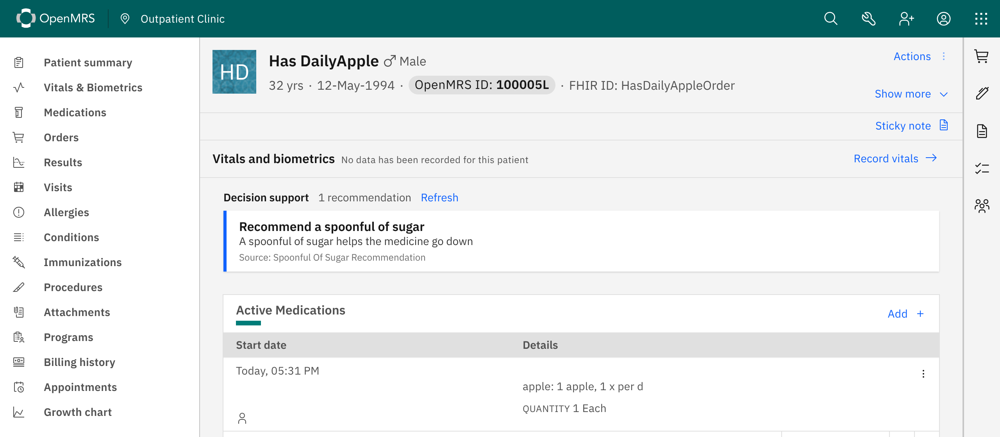
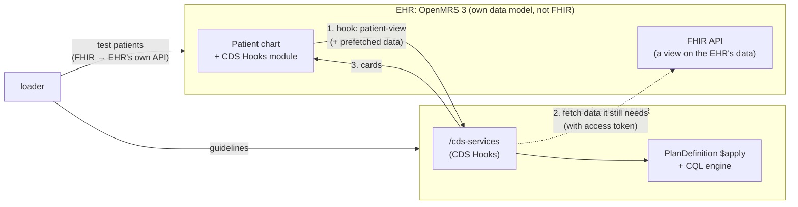
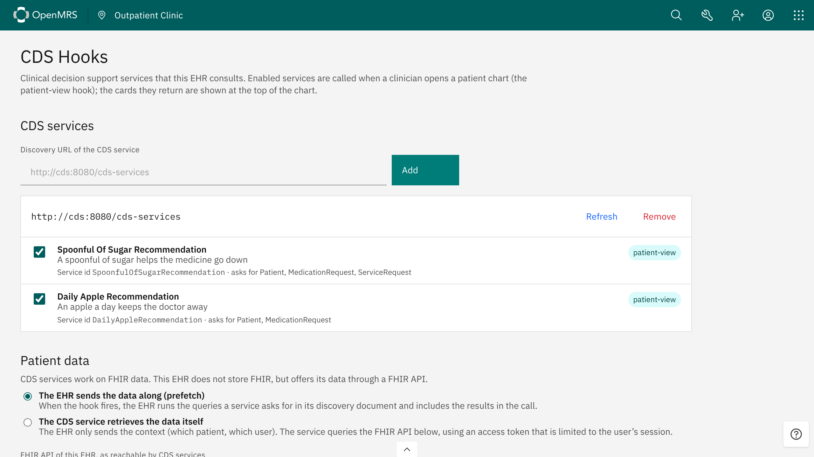

# EHR guideline demo

Shows FHIR/CQL guidelines ([CPG](https://hl7.org/fhir/uv/cpg/)) at work where clinicians meet them: as recommendation cards in the patient chart of an EHR, delivered with [CDS Hooks](https://cds-hooks.hl7.org/).

The whole round trip runs in Docker:

1. As an **administrator**, register a CDS service in the EHR and choose which of its services clinicians get to see.
2. As a **clinician**, open a patient chart. The EHR calls the service (`patient-view`), the service runs the guideline on the patient's data, and its recommendations appear as cards at the top of the chart.

Out of the box it loads the example guidelines of [cpg-example](https://github.com/wardweistra/cpg-example) and their test patients.





## Start

Requires Docker with Compose, and about 6 GB of memory for Docker.

```bash
docker compose up -d --build
```

```bash
docker compose logs -f loader
```

The loader waits until everything is up, loads the guidelines and the test patients, and ends by listing the test patients with a link to their chart. The first start takes 5 to 10 minutes, because OpenMRS then creates its database; later starts take a few minutes.

| | URL | Login |
|---|---|---|
| EHR | <http://localhost:8081/openmrs/spa> | `admin` / `Admin123` (administrator, and a clinician too), `doctor` / `Doctor123` (clinician, view only) |
| CDS service: discovery | <http://localhost:8080/cds-services> | |
| CDS service: FHIR API (for Postman, `$apply`) | <http://localhost:8080/fhir> | |

Stop with `docker compose down`; add `-v` to also throw away the EHR's database.

Ports and versions can be changed with environment variables (or a `.env` file): `EHR_PORT` (8081), `CDS_PORT` (8080), `O3_TAG` (OpenMRS reference application, 3.8.0), `HAPI_TAG`.

## The demo

### 1. Administrator: configure CDS Hooks

1. Log in to the EHR as `admin` and pick any location.
2. Open the app menu (top right) → **System Administration** → **CDS Hooks**.
3. Enter the discovery URL of the CDS service, `http://cds:8080/cds-services`, and choose **Add**. The EHR asks the service what it offers and lists the answer: one service per guideline, each for the `patient-view` hook.
4. Tick the services that clinicians should see. Changes are saved as you make them.



`http://cds:8080` is the address of the CDS service as the EHR's server sees it; in a browser the same service is at `http://localhost:8080`.

### 2. Clinician: open a patient chart

1. Log in as `doctor` (or stay logged in as `admin`).
2. Search for a test patient (magnifying glass, e.g. "DailyApple" or "SpoonfulOfSugar") and open the chart.
3. **Decision support** at the top of the chart shows the cards, or says that the services had no recommendations for this patient.

With both guidelines enabled, the test patients show:

| Test patient | Card | Why |
|---|---|---|
| Needs DailyApple | Recommend a daily apple | No apple order |
| Has DailyApple | Recommend a spoonful of sugar | Has an apple order; that is a medication, so sugar is recommended |
| Needs SpoonfulOfSugar | Recommend a spoonful of sugar | Has a medication, no sugar order |
| DoesNotNeed SpoonfulOfSugar | Recommend a daily apple | No medication, so no sugar; no apple order either |
| Has SpoonfulOfSugar | none | Has both orders |
| Refused DailyApple | Recommend a daily apple | See below: differs from the test case |
| Refused SpoonfulOfSugar | Recommend a spoonful of sugar | See below: differs from the test case |

The two "Refused" patients behave differently than their test case says, and that is the point of having a real EHR in the demo. Their FHIR test data holds a request with `doNotPerform: true`. OpenMRS, like most EHRs, cannot record an order *not* to do something, so that information never reaches the EHR, and the guideline cannot take it into account.

### 3. Change something in the EHR

Logged in as `admin`, open the chart of **Needs DailyApple** and prescribe any medication: **Medications** → **Record active medications**, start a visit when the EHR asks for one, search for a drug (e.g. "aspirin"), choose **Order form**, fill it in, and **Sign and close** the order basket. Back at the top of the chart choose **Refresh**: besides the apple, a spoonful of sugar is now recommended, because the patient has a medication.

Use `admin` for this: the `doctor` account of the OpenMRS demo data can open charts, but is not allowed to start a visit.

To put all test patients back in their original state: `docker compose run --rm loader patients`.

### 4. Where the patient data comes from

The EHR does not store FHIR; the guideline needs FHIR. The CDS Hooks administration page offers the two ways CDS Hooks has for this, under **Patient data**:

- **The EHR sends the data along (prefetch).** A CDS service states in its discovery document which data it needs, as FHIR queries. When the hook fires, the EHR runs those queries on its own FHIR API and includes the results in the call.
- **The CDS service retrieves the data itself.** The EHR only sends who the patient and the user are, plus the address of its FHIR API and an access token. The service runs the same queries against the EHR.

Switch between them and open a chart again: the cards are the same. To see the difference, follow the log of the CDS service (`docker compose logs -f cds`), which shows every hook request it receives and, in the second mode, lines like `Fetching with MedicationRequest?subject=Patient/...`. The browser's developer tools (Network tab, filter on `cds-hooks-relay`) show the request and the cards that come back.

## Other guidelines and patients

The loader reads a guideline project in the layout of [cpg-example](https://github.com/wardweistra/cpg-example), from source. The IG does not have to be built.

| Part of the project | Goes to |
|---|---|
| `input/resources`, `input/vocabulary`: PlanDefinition, ActivityDefinition, Library, ValueSet, CodeSystem, ... | CDS service |
| `input/cql/*.cql` | CDS service, embedded in the Library with the same name |
| `input/tests/**`: Patients and the resources that refer to them (without tests: the bundles in `input/examples`) | EHR |

Load a project from a local folder:

```bash
GUIDELINES_DIR=../my-guidelines docker compose run --rm loader
```

or from GitHub (optionally `#branch-or-tag`):

```bash
docker compose run --rm loader all https://github.com/wardweistra/cpg-example
```

`loader guidelines` and `loader patients` load only that part. Loading is repeatable: guidelines are replaced, and test patients get their orders replaced. To make `docker compose up` load another project by default, set `GUIDELINES_DIR` or `GUIDELINES_REPO` in a `.env` file.

After loading new guidelines, their services appear in the EHR after **Refresh** on the CDS Hooks administration page, where they still have to be enabled.

### Try a change

`docs/example-change.patch` changes cpg-example a little, to see a change travel to the chart:

- test data: a new patient, Child DailyApple (born in 2019), and a sugar order for Has DailyApple;
- guideline: the daily apple is only recommended from the age of 18 (CQL), and its card gets a new text and becomes a warning (PlanDefinition).

```bash
git clone https://github.com/wardweistra/cpg-example ../cpg-example
git -C ../cpg-example apply "$PWD/docs/example-change.patch"
```

Load the test data, and look at the two patients in the EHR: the child gets the apple card, and Has DailyApple has lost its sugar card.

```bash
GUIDELINES_DIR=../cpg-example docker compose run --rm loader patients
```

Then load the guideline, and open the charts again: the child no longer gets the apple card, and Needs DailyApple gets it with the new text, in yellow. Nothing has to change in the EHR.

```bash
GUIDELINES_DIR=../cpg-example docker compose run --rm loader guidelines
```

### What the loader does to guidelines

It loads them as they are, except for what HAPI needs to offer a PlanDefinition as a CDS Hooks service:

- **Hook.** HAPI takes the hook from a trigger on the PlanDefinition's action (`"trigger": [{ "type": "named-event", "name": "patient-view" }]`). PlanDefinitions without one get `patient-view` (`DEFAULT_HOOK`). Better: add the trigger to the guideline itself.
- **Data requirements.** HAPI derives the prefetch queries from the Library's `dataRequirement`, which the IG publisher normally fills in. The loader gets them from HAPI's `$data-requirements` instead.
- **Card text.** A card's detail is the action's `description`; where that is missing, `textEquivalent` is used.

What ends up on a card comes from the PlanDefinition's action: `title` → summary, `description` → detail, `priority` (`routine`, `urgent`, `stat`) → indicator (info, warning, critical), `documentation` → source, and the PlanDefinition's `relatedArtifact` → links.

### What the loader does to patients

OpenMRS has its own data model and API, so the FHIR test data is translated:

| FHIR | OpenMRS |
|---|---|
| Patient | Patient, with the FHIR id as an extra identifier ("FHIR ID") by which it is found again |
| MedicationRequest (active order) | Drug order |
| ServiceRequest (active order) | Test order |
| Codings | Concepts in the OpenMRS dictionary, created when missing and mapped to the code |

Anything else is reported and skipped: other resource types, and requests that are not active orders (proposals, plans, `doNotPerform`), which OpenMRS cannot express.

### Code systems

OpenMRS identifies everything with concepts from its own dictionary. A concept can be mapped to codes in other code systems, and OpenMRS's FHIR API shows those codes only for code systems of which it knows the FHIR URL. That list is configuration: `ehr/backend/openmrs_config/`, in the format of the OpenMRS [Initializer](https://github.com/mekomsolutions/openmrs-module-initializer) module.

When test data uses a code system that is not in the list, the loader says so. Add a line to both `conceptsources/zz-guideline-demo/conceptsources.csv` (name of the code system in OpenMRS) and `fhirconceptsources/zz-guideline-demo/fhirconceptsources.csv` (its FHIR URL), give each line a new UUID, and restart the EHR's backend: `docker compose restart backend`. SNOMED CT, LOINC and CIEL are known already.

## How it is built

Almost everything is stock open-source software; the parts made for this demo are small.

| Service | What | Made for this demo |
|---|---|---|
| `cds` | [HAPI FHIR](https://hapifhir.io/) with clinical reasoning and CDS Hooks enabled. Stores the guidelines and offers every PlanDefinition on `/cds-services`; a hook call runs `$apply` and turns the result into cards. | Nothing: two settings. |
| `backend`, `db`, `gateway` | [OpenMRS 3 reference application](https://github.com/openmrs/openmrs-distro-referenceapplication). Its FHIR API (the FHIR2 module) translates the EHR's own data to FHIR on request. | Configuration: code systems (see above). |
| `frontend` | The OpenMRS 3 frontend. | `ehr/frontend/cds-hooks-app`: a frontend module with the CDS Hooks administration page and the cards in the chart. One JavaScript file, no build. |
| `ehr` | nginx in front of OpenMRS. | `ehr/edge/nginx.conf`: the relay through which the EHR calls CDS services, and access tokens for the FHIR API. |
| `loader` | Node.js scripts without dependencies. | `loader/`: guidelines to the CDS service, test patients to the EHR. |

We found no open-source EHR with its own data model that has a CDS Hooks client built in, which is why the module exists. It supports the `patient-view` hook and shows a card's summary, detail, indicator, source and links. It does not support suggestions (accepting a proposed order), SMART app links or feedback.

The CDS Hooks configuration is stored in the EHR as the system setting `cdshooks.configuration`.

### Things to know

- **Medications by reference.** An order placed in the EHR's own screens is for a product from the EHR's drug list. In FHIR that becomes a MedicationRequest with a `medicationReference` to a Medication resource, as in many EHRs. The CQL of cpg-example looks for the code on the request itself (`[MedicationRequest: "Apple"]`), and HAPI does not follow the reference. So an apple prescribed in the EHR's screens would not count as an apple order; the loader therefore creates the test orders for a concept instead of a product. Guideline CQL that has to work with real EHR data should handle both forms.
- **Demo-grade security.** The access token a CDS service receives is the id of the user's EHR session, and the relay passes calls on to any address a logged-in user gives it. Fine on a laptop, not for real patient data: a real EHR issues short-lived, read-only OAuth tokens and only calls registered services. Everything runs over plain HTTP with default passwords.
- **Upgrading.** `O3_TAG` and `HAPI_TAG` select the versions of OpenMRS and HAPI. The CDS Hooks module relies on how the OpenMRS app shell loads modules and on the slot `top-of-all-patient-dashboards-slot` in the patient chart; check both the admin page and a chart after upgrading OpenMRS.
